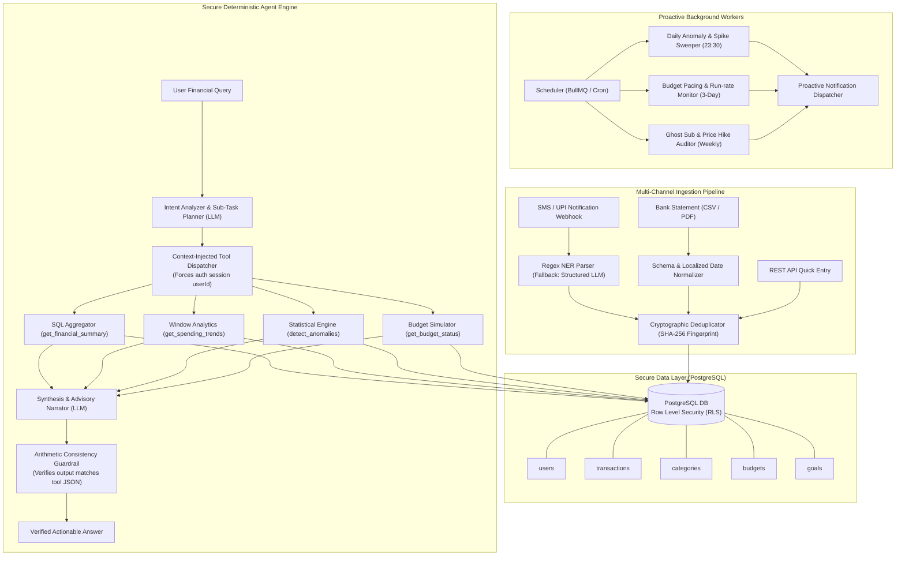

# aiFinance 💸🤖

> **An intelligent, autonomous personal finance backend featuring deterministic calculations, multi-channel transaction ingestion, proactive background monitoring, and a secure multi-tenant AI reasoning agent.**

[](https://opensource.org/licenses/MIT)
[](https://nodejs.org/)
[](https://www.typescriptlang.org/)
[](https://www.postgresql.org/)
[](#system-architecture)

---

## 📌 Executive Overview

Traditional expense trackers are passive data-entry logs requiring constant manual maintenance. Meanwhile, typical "AI finance chatbots" are unreliable wrappers that hallucinate arithmetic, risk cross-tenant data leaks, and sit idle until prompted.

**aiFinance** re-engineers personal financial management into an **auditable, proactive, and deterministic autonomous backend system**:

1. **Deterministic Analytics over Hallucinated Math:** The LLM is used strictly for **intent routing, reasoning, and narrative explanation**. All arithmetic (sums, averages, moving trends, category variance, and anomaly thresholds) is computed deterministically in **PostgreSQL and native TypeScript code**.
2. **Messy Real-World Data Ingestion:** Automated ingestion for **UPI & SMS alerts via Regex NER**, **bank statement parsers (CSV & PDF)**, and **cryptographic transaction deduplication** (`SHA-256` sliding-window fingerprinting).
3. **Ironclad Multi-Tenant Security:** Injected tenant context pattern and **PostgreSQL Row Level Security (RLS)** prevent any tool or prompt injection from accessing another user's financial records.
4. **Proactive Background Intelligence:** Automated background workers run continuous checks for **midnight spending anomalies, mid-month budget burn pacing, and recurring subscription price creep**.
5. **Scientific Evaluation:** Automated benchmarking harness measuring **Multi-class Precision/Recall/F1**, **ROC-AUC for anomaly detection**, and **100% Numeric Faithfulness** verification on agent outputs.

---

## 🏛️ System Architecture



---

## 🎯 Direct Response to Faculty Evaluation Points

For the comprehensive academic and architectural defense document, see [FACULTY_FEEDBACK_DEFENSE.md](file:///Users/ayushdev/Downloads/aiiFnance/docs/FACULTY_FEEDBACK_DEFENSE.md).

### 1. Data Source & Real, Messy Data
- **UPI & SMS Notification Ingestion:** Dual-stage parser. Stage 1 executes deterministic regex NER extracting amount, merchant/VPA, account tail, and UTR reference in $< 1\text{ms}$. Stage 2 routes low-confidence ($< 0.85$) or informal messages to a schema-bounded structured LLM parser.
- **Statement Parsers:** Normalizes localized date formats (`DD/MM/YYYY`, `MM/DD/YYYY`), negative-sign debit/credit representations, and Indian/International number commas (`1,00,000.00`).
- **Cryptographic Deduplication:** Prevents duplicate records between real-time SMS alerts and uploaded monthly bank statements using a composite fingerprint:
  $$\text{Fingerprint} = \text{SHA-256}(\text{userId} \parallel \text{Day}(\text{date}) \parallel \text{Round}(\text{amount}, 2) \parallel \text{type} \parallel \text{NormalizedMerchant})$$

### 2. Agent Design: Deterministic Tools & Multi-Step Workflow
The LLM **never** does mental math. All aggregations and analytics are executed by dedicated backend tools:

| Registered Tool | Execution Layer | Purpose |
| :--- | :--- | :--- |
| `get_financial_summary` | PostgreSQL Aggregate Query | `SUM`, `AVG`, `COUNT`, net cash flow, income vs expenses over date ranges. |
| `get_spending_trends` | PostgreSQL Window Functions | Month-over-Month (MoM) growth velocity and category percentage shares. |
| `query_transactions` | Parameterized SQL Index Scan | Filtered search by category, merchant, date, amount with bounded pagination. |
| `detect_spending_anomalies` | Node.js / SQL Math Engine | Computes Modified Z-scores and IQR to surface true statistical outliers. |
| `get_budget_status` | PostgreSQL Join Query | Real-time budget limit vs consumed expenditure and remaining daily burn rate. |
| `project_savings_trajectory` | Deterministic Math Engine | Amortization and compound interest calculations for savings goals. |

**Multi-Step Workflow:**
1. **Deconstruct:** The agent decomposes user questions into a structured execution plan.
2. **Execute:** Calls deterministic tools via JSON schemas (injecting the authenticated `userId`).
3. **Synthesize:** Combines deterministic numerical outputs with user goals to craft strategic recommendations.
4. **Guardrail:** Programmatic check ensures every currency figure in the narrative matches tool outputs exactly.

### 3. Security & Multi-Tenant Isolation
- **Injected Context Pattern:** The LLM schema contains **no** `userId` parameter. The backend middleware injects `req.user.id` into the tool handler. Any hallucinated `userId` in tool arguments is strictly ignored.
- **PostgreSQL Row Level Security (RLS):** Database enforces `CREATE POLICY ... USING (user_id = current_setting('app.current_user_id')::uuid)`. Even if an SQL injection bug occurred, cross-tenant data access is blocked by the DB engine.
- **Prompt Injection Defense:** External strings (merchant names, notes) are sanitized and wrapped in `<untrusted_transaction_data>` XML tags.
- **Human-In-The-Loop (HITL):** Destructive actions (deletions, budget resets) generate a staged action token requiring explicit confirmation.

### 4. Proactive Background Jobs
`aiFinance` is an active financial watchdog running scheduled background workers:

1. **Daily Midnight Anomaly Sweeper (23:30):** Compares past 24h transactions against a 90-day moving category baseline. Flags charges $> \mu + 2.5\sigma$ and duplicate charges within 15 minutes.
2. **Budget Pacing & Run-Rate Monitor (Every 3 Days):** Forecasts month-end spend using burn rate formula $\text{Projected} = (\text{CurrentSpend} / \text{DaysElapsed}) \times \text{DaysInMonth}$. Alerts if projected spend $> 105\%$ of budget before Day 20.
3. **Subscription & Price-Creep Auditor (Weekly):** Detects 28–31 day recurrence patterns and alerts on silent price hikes.
4. **Weekly Financial Health Digest (Mondays):** Summarizes net savings rate and highlights top spending leaks.

### 5. Evaluation & Accuracy Metrics
The automated evaluation harness (`npm run eval`) measures performance on curated datasets:
- **Categorization:** Multi-class Precision, Recall, and Macro-F1 (Target $\ge 0.90$) across 12 standard categories, plus Out-Of-Distribution (OOD) fallback rates.
- **Anomaly Detection:** ROC-AUC (Target $\ge 0.92$), Precision@K (Target $\ge 0.88$ at $K=5$), and False Positive Rate ($\le 2\%$).
- **Agent Faithfulness:** 100% verification that all numbers in LLM responses match tool output JSON.

---

## 🗄️ Database Schema (PostgreSQL + RLS)

```sql
-- Core Schema with Tenant Isolation
CREATE TABLE users (
    id UUID PRIMARY KEY DEFAULT gen_random_uuid(),
    email VARCHAR(255) UNIQUE NOT NULL,
    password_hash VARCHAR(255) NOT NULL,
    currency VARCHAR(3) DEFAULT 'USD',
    created_at TIMESTAMP WITH TIME ZONE DEFAULT CURRENT_TIMESTAMP
);

CREATE TABLE categories (
    id UUID PRIMARY KEY DEFAULT gen_random_uuid(),
    name VARCHAR(100) NOT NULL,
    is_system BOOLEAN DEFAULT true,
    user_id UUID REFERENCES users(id) ON DELETE CASCADE
);

CREATE TABLE transactions (
    id UUID PRIMARY KEY DEFAULT gen_random_uuid(),
    user_id UUID NOT NULL REFERENCES users(id) ON DELETE CASCADE,
    category_id UUID REFERENCES categories(id) ON DELETE SET NULL,
    amount NUMERIC(12, 2) NOT NULL,
    type VARCHAR(10) NOT NULL CHECK (type IN ('debit', 'credit')),
    raw_description TEXT NOT NULL,
    normalized_merchant VARCHAR(255),
    transaction_date TIMESTAMP WITH TIME ZONE NOT NULL,
    source VARCHAR(20) NOT NULL CHECK (source IN ('manual', 'sms', 'csv', 'pdf')),
    fingerprint CHAR(64) NOT NULL,
    reference_id VARCHAR(100),
    created_at TIMESTAMP WITH TIME ZONE DEFAULT CURRENT_TIMESTAMP
);

CREATE TABLE budgets (
    id UUID PRIMARY KEY DEFAULT gen_random_uuid(),
    user_id UUID NOT NULL REFERENCES users(id) ON DELETE CASCADE,
    category_id UUID NOT NULL REFERENCES categories(id) ON DELETE CASCADE,
    monthly_limit NUMERIC(12, 2) NOT NULL,
    month INT NOT NULL,
    year INT NOT NULL,
    UNIQUE(user_id, category_id, month, year)
);

CREATE TABLE proactive_alerts (
    id UUID PRIMARY KEY DEFAULT gen_random_uuid(),
    user_id UUID NOT NULL REFERENCES users(id) ON DELETE CASCADE,
    alert_type VARCHAR(50) NOT NULL,
    severity VARCHAR(20) NOT NULL CHECK (severity IN ('info', 'warning', 'critical')),
    title VARCHAR(255) NOT NULL,
    message TEXT NOT NULL,
    is_read BOOLEAN DEFAULT false,
    created_at TIMESTAMP WITH TIME ZONE DEFAULT CURRENT_TIMESTAMP
);

-- Enable Row Level Security (RLS)
ALTER TABLE transactions ENABLE ROW LEVEL SECURITY;
ALTER TABLE budgets ENABLE ROW LEVEL SECURITY;
ALTER TABLE proactive_alerts ENABLE ROW LEVEL SECURITY;

CREATE POLICY user_isolation_transactions ON transactions
    FOR ALL USING (user_id = NULLIF(current_setting('app.current_user_id', true), '')::uuid);
```

---

## 🚀 Quick Start Guide

### Prerequisites
- Node.js $\ge 20.0.0$
- PostgreSQL $\ge 15.0$

### 1. Installation
```bash
git clone https://github.com/Aayushdev18/aiFinance.git
cd aiFinance
npm install
```

### 2. Environment Configuration
Copy `.env.example` and fill in your credentials:
```bash
cp .env.example .env
```
Key configuration items:
- `DATABASE_URL`: PostgreSQL connection string.
- `JWT_SECRET`: Secret key for secure authentication tokens.
- `GEMINI_API_KEY`: API key for the LLM reasoning agent.

### 3. Run Development Server
```bash
npm run dev
```
The server will start on `http://localhost:5000`.

### 4. Run Evaluation Suite
Execute the automated categorization and anomaly detection benchmark:
```bash
npm run eval
```

---

## 📡 Key API Endpoints

### Ingestion & Transactions
- `POST /api/ingest/sms`: Ingests raw SMS/UPI notification text.
- `POST /api/ingest/csv`: Multipart bank statement upload with automated column mapping.
- `GET /api/transactions`: Paginated transaction list with category and date filtering.

### Deterministic Agent
- `POST /api/agent/chat`: Send financial queries to the multi-step reasoning agent.
- `GET /api/agent/history`: Retrieve conversation threads and audited tool executions.

### Proactive Surveillance
- `GET /api/alerts`: List active proactive alerts (anomalies, budget pacing warnings).
- `POST /api/alerts/:id/read`: Acknowledge an alert.

---

## 📁 Repository Structure

```
aiFinance/
├── docs/
│   └── FACULTY_FEEDBACK_DEFENSE.md    # Comprehensive faculty review defense document
├── src/
│   ├── config/                        # DB pool & environment variables
│   ├── db/                            # PostgreSQL connection & migrations
│   ├── services/
│   │   ├── ingestion/
│   │   │   ├── smsParser.ts           # Regex NER & LLM fallback parser
│   │   │   ├── csvParser.ts           # Bank statement dialect normalizer
│   │   │   └── deduplicator.ts        # SHA-256 fingerprint deduplication
│   │   ├── analytics/
│   │   │   ├── sqlAnalytics.ts        # Deterministic aggregations & trends
│   │   │   └── anomalyDetector.ts     # Statistical Modified Z-score engine
│   │   ├── agent/
│   │   │   ├── tools.ts               # Context-injected deterministic tools
│   │   │   ├── agentWorkflow.ts       # Multi-step decision making & guardrails
│   │   │   └── prompts.ts             # System prompts with prompt injection defenses
│   │   └── jobs/
│   │       └── scheduler.ts           # Proactive background workers (BullMQ/Cron)
│   ├── middleware/
│   │   ├── tenantContext.ts           # JWT verification & RLS session injection
│   │   └── errorHandler.ts            # Centralized API error handling
│   ├── controllers/                   # Route controllers (auth, transactions, agent)
│   ├── routes/                        # Express API route declarations
│   ├── eval/                          # Automated evaluation harness & test dataset
│   │   ├── dataset.json               # 100+ ground-truth labeled transactions
│   │   └── evaluationRunner.ts        # Precision/Recall/F1 & Faithfulness tester
│   └── index.ts                       # Server bootstrap
├── .env.example
├── package.json
├── tsconfig.json
└── README.md
```

---

## 📄 License
This project is licensed under the MIT License – see the [LICENSE](LICENSE) file for details.
