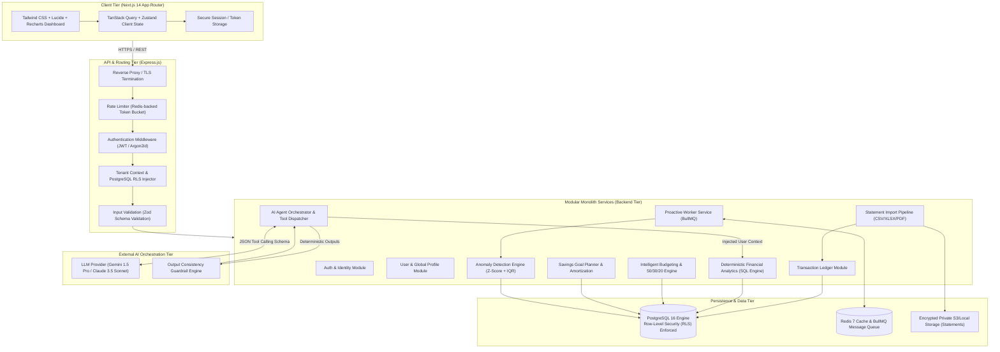
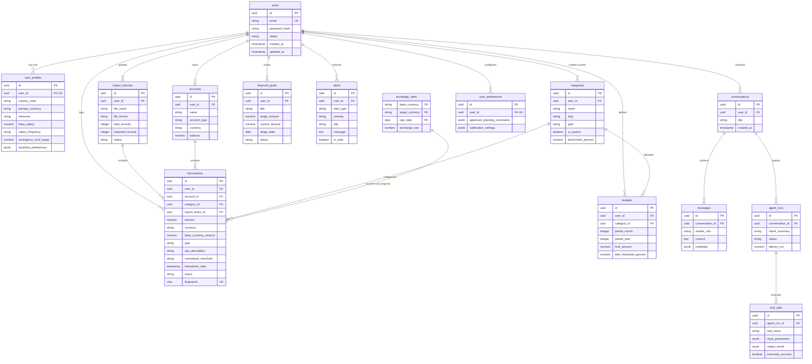

# FinPilot AI — System Architecture & Engineering Specification

**Document Version:** 1.0.0  
**Status:** Approved Architectural Blueprint  
**System Classification:** Multi-Tenant Global Personal Financial Intelligence Platform  

---

## 1. High-Level System Architecture

FinPilot AI is structured as a **decoupled, modular architecture**: a **Next.js client** coupled with a **modular Node.js/Express backend**, backed by **PostgreSQL (with native Row-Level Security)**, **Redis/BullMQ for asynchronous financial telemetry and proactive jobs**, and a **deterministic AI agent orchestrator**.



---

## 2. Database Entity-Relationship (ER) Diagram

The system employs a normalized 3NF schema partitioned by `user_id` across every tenant-owned table, protected by foreign keys, audit timestamps, and PostgreSQL Row-Level Security (RLS).



---

## 3. Detailed PostgreSQL DDL Schema (Production-Grade with RLS)

```sql
-- PostgreSQL Extension Configuration
CREATE EXTENSION IF NOT EXISTS "uuid-ossp";
CREATE EXTENSION IF NOT EXISTS "pgcrypto";

-- ============================================================================
-- 1. USERS & GLOBAL TENANT PROFILES
-- ============================================================================
CREATE TABLE users (
    id UUID PRIMARY KEY DEFAULT gen_random_uuid(),
    email VARCHAR(255) UNIQUE NOT NULL,
    password_hash VARCHAR(255) NOT NULL,
    status VARCHAR(50) DEFAULT 'active' CHECK (status IN ('active', 'suspended', 'pending_verification')),
    created_at TIMESTAMPTZ NOT NULL DEFAULT CURRENT_TIMESTAMP,
    updated_at TIMESTAMPTZ NOT NULL DEFAULT CURRENT_TIMESTAMP
);

CREATE TABLE user_profiles (
    id UUID PRIMARY KEY DEFAULT gen_random_uuid(),
    user_id UUID UNIQUE NOT NULL REFERENCES users(id) ON DELETE CASCADE,
    country_code VARCHAR(2) NOT NULL, -- ISO 3166-1 alpha-2 (e.g., 'US', 'GB', 'IN', 'DE')
    primary_currency VARCHAR(3) NOT NULL, -- ISO 4217 (e.g., 'USD', 'EUR', 'GBP', 'INR', 'JPY')
    timezone VARCHAR(100) NOT NULL DEFAULT 'UTC',
    base_salary NUMERIC(14, 2) NOT NULL DEFAULT 0.00,
    salary_frequency VARCHAR(20) NOT NULL DEFAULT 'monthly' 
        CHECK (salary_frequency IN ('weekly', 'biweekly', 'monthly', 'annually')),
    emergency_fund_target NUMERIC(14, 2) DEFAULT 0.00,
    localized_preferences JSONB DEFAULT '{"date_format": "YYYY-MM-DD", "number_format": "en-US"}'::jsonb,
    created_at TIMESTAMPTZ NOT NULL DEFAULT CURRENT_TIMESTAMP,
    updated_at TIMESTAMPTZ NOT NULL DEFAULT CURRENT_TIMESTAMP
);

-- ============================================================================
-- 2. ACCOUNTS & FINANCIAL CATEGORIES
-- ============================================================================
CREATE TABLE accounts (
    id UUID PRIMARY KEY DEFAULT gen_random_uuid(),
    user_id UUID NOT NULL REFERENCES users(id) ON DELETE CASCADE,
    name VARCHAR(100) NOT NULL,
    account_type VARCHAR(50) NOT NULL CHECK (account_type IN ('checking', 'savings', 'credit_card', 'investment', 'cash')),
    currency VARCHAR(3) NOT NULL,
    balance NUMERIC(14, 2) NOT NULL DEFAULT 0.00,
    created_at TIMESTAMPTZ NOT NULL DEFAULT CURRENT_TIMESTAMP,
    updated_at TIMESTAMPTZ NOT NULL DEFAULT CURRENT_TIMESTAMP
);

CREATE TABLE categories (
    id UUID PRIMARY KEY DEFAULT gen_random_uuid(),
    user_id UUID REFERENCES users(id) ON DELETE CASCADE, -- NULL for system-wide defaults
    name VARCHAR(100) NOT NULL,
    slug VARCHAR(100) NOT NULL,
    type VARCHAR(20) NOT NULL CHECK (type IN ('income', 'expense', 'transfer')),
    is_system BOOLEAN NOT NULL DEFAULT false,
    benchmark_percent NUMERIC(5, 2) DEFAULT 0.00, -- Recommended max % of income
    created_at TIMESTAMPTZ NOT NULL DEFAULT CURRENT_TIMESTAMP
);

CREATE UNIQUE INDEX idx_categories_user_slug ON categories(COALESCE(user_id, '00000000-0000-0000-0000-000000000000'::uuid), slug);

-- ============================================================================
-- 3. IMPORT BATCHES & TRANSACTIONS
-- ============================================================================
CREATE TABLE import_batches (
    id UUID PRIMARY KEY DEFAULT gen_random_uuid(),
    user_id UUID NOT NULL REFERENCES users(id) ON DELETE CASCADE,
    file_name VARCHAR(255) NOT NULL,
    file_format VARCHAR(20) NOT NULL CHECK (file_format IN ('csv', 'xlsx', 'pdf')),
    total_records INT NOT NULL DEFAULT 0,
    imported_records INT NOT NULL DEFAULT 0,
    duplicate_records INT NOT NULL DEFAULT 0,
    status VARCHAR(50) NOT NULL DEFAULT 'pending_review' 
        CHECK (status IN ('uploaded', 'parsing', 'pending_review', 'committed', 'failed')),
    created_at TIMESTAMPTZ NOT NULL DEFAULT CURRENT_TIMESTAMP
);

CREATE TABLE transactions (
    id UUID PRIMARY KEY DEFAULT gen_random_uuid(),
    user_id UUID NOT NULL REFERENCES users(id) ON DELETE CASCADE,
    account_id UUID REFERENCES accounts(id) ON DELETE SET NULL,
    category_id UUID REFERENCES categories(id) ON DELETE SET NULL,
    import_batch_id UUID REFERENCES import_batches(id) ON DELETE SET NULL,
    amount NUMERIC(14, 2) NOT NULL,
    currency VARCHAR(3) NOT NULL,
    base_currency_amount NUMERIC(14, 2) NOT NULL, -- Normalized to user_profile.primary_currency
    type VARCHAR(10) NOT NULL CHECK (type IN ('debit', 'credit')),
    raw_description TEXT NOT NULL,
    normalized_merchant VARCHAR(255),
    transaction_date TIMESTAMPTZ NOT NULL,
    source VARCHAR(20) NOT NULL CHECK (source IN ('manual', 'sms', 'csv', 'xlsx', 'pdf')),
    status VARCHAR(20) NOT NULL DEFAULT 'cleared' CHECK (status IN ('pending', 'cleared', 'reconciled')),
    fingerprint CHAR(64) NOT NULL, -- SHA-256 for sliding-window deduplication
    created_at TIMESTAMPTZ NOT NULL DEFAULT CURRENT_TIMESTAMP
);

CREATE INDEX idx_transactions_user_date ON transactions(user_id, transaction_date DESC);
CREATE INDEX idx_transactions_user_category ON transactions(user_id, category_id);
CREATE UNIQUE INDEX idx_transactions_dedup ON transactions(user_id, fingerprint);

-- ============================================================================
-- 4. BUDGETS & FINANCIAL GOALS
-- ============================================================================
CREATE TABLE budgets (
    id UUID PRIMARY KEY DEFAULT gen_random_uuid(),
    user_id UUID NOT NULL REFERENCES users(id) ON DELETE CASCADE,
    category_id UUID NOT NULL REFERENCES categories(id) ON DELETE CASCADE,
    period_month SMALLINT NOT NULL CHECK (period_month BETWEEN 1 AND 12),
    period_year SMALLINT NOT NULL CHECK (period_year BETWEEN 2020 AND 2100),
    limit_amount NUMERIC(14, 2) NOT NULL,
    alert_threshold_percent NUMERIC(5, 2) NOT NULL DEFAULT 85.00,
    created_at TIMESTAMPTZ NOT NULL DEFAULT CURRENT_TIMESTAMP,
    UNIQUE(user_id, category_id, period_month, period_year)
);

CREATE TABLE financial_goals (
    id UUID PRIMARY KEY DEFAULT gen_random_uuid(),
    user_id UUID NOT NULL REFERENCES users(id) ON DELETE CASCADE,
    title VARCHAR(255) NOT NULL,
    target_amount NUMERIC(14, 2) NOT NULL,
    current_amount NUMERIC(14, 2) NOT NULL DEFAULT 0.00,
    target_date DATE NOT NULL,
    status VARCHAR(20) NOT NULL DEFAULT 'in_progress' 
        CHECK (status IN ('in_progress', 'achieved', 'paused', 'abandoned')),
    created_at TIMESTAMPTZ NOT NULL DEFAULT CURRENT_TIMESTAMP,
    updated_at TIMESTAMPTZ NOT NULL DEFAULT CURRENT_TIMESTAMP
);

-- ============================================================================
-- 5. AUDITABLE AI AGENT LOGS & PERSISTENT MEMORY
-- ============================================================================
CREATE TABLE conversations (
    id UUID PRIMARY KEY DEFAULT gen_random_uuid(),
    user_id UUID NOT NULL REFERENCES users(id) ON DELETE CASCADE,
    title VARCHAR(255) NOT NULL DEFAULT 'Financial Inquiry',
    created_at TIMESTAMPTZ NOT NULL DEFAULT CURRENT_TIMESTAMP,
    updated_at TIMESTAMPTZ NOT NULL DEFAULT CURRENT_TIMESTAMP
);

CREATE TABLE messages (
    id UUID PRIMARY KEY DEFAULT gen_random_uuid(),
    conversation_id UUID NOT NULL REFERENCES conversations(id) ON DELETE CASCADE,
    sender_role VARCHAR(20) NOT NULL CHECK (sender_role IN ('user', 'assistant', 'system')),
    content TEXT NOT NULL,
    metadata JSONB DEFAULT '{}'::jsonb,
    created_at TIMESTAMPTZ NOT NULL DEFAULT CURRENT_TIMESTAMP
);

CREATE TABLE agent_runs (
    id UUID PRIMARY KEY DEFAULT gen_random_uuid(),
    conversation_id UUID NOT NULL REFERENCES conversations(id) ON DELETE CASCADE,
    intent_summary TEXT,
    execution_status VARCHAR(50) NOT NULL DEFAULT 'running' CHECK (execution_status IN ('running', 'completed', 'failed')),
    latency_ms INT,
    created_at TIMESTAMPTZ NOT NULL DEFAULT CURRENT_TIMESTAMP
);

CREATE TABLE tool_calls (
    id UUID PRIMARY KEY DEFAULT gen_random_uuid(),
    agent_run_id UUID NOT NULL REFERENCES agent_runs(id) ON DELETE CASCADE,
    tool_name VARCHAR(100) NOT NULL,
    input_parameters JSONB NOT NULL,
    output_result JSONB NOT NULL,
    execution_success BOOLEAN NOT NULL DEFAULT true,
    error_message TEXT,
    created_at TIMESTAMPTZ NOT NULL DEFAULT CURRENT_TIMESTAMP
);

CREATE TABLE user_preferences (
    id UUID PRIMARY KEY DEFAULT gen_random_uuid(),
    user_id UUID UNIQUE NOT NULL REFERENCES users(id) ON DELETE CASCADE,
    approved_planning_constraints JSONB NOT NULL DEFAULT '{"max_dining_pct": 0.10, "min_savings_pct": 0.20}'::jsonb,
    notification_settings JSONB NOT NULL DEFAULT '{"daily_anomaly_alerts": true, "pacing_warnings": true, "weekly_digest": true}'::jsonb,
    created_at TIMESTAMPTZ NOT NULL DEFAULT CURRENT_TIMESTAMP,
    updated_at TIMESTAMPTZ NOT NULL DEFAULT CURRENT_TIMESTAMP
);

-- ============================================================================
-- 6. GLOBAL EXCHANGE RATES & PROACTIVE ALERTS
-- ============================================================================
CREATE TABLE exchange_rates (
    base_currency VARCHAR(3) NOT NULL,
    target_currency VARCHAR(3) NOT NULL,
    rate_date DATE NOT NULL,
    exchange_rate NUMERIC(16, 6) NOT NULL,
    PRIMARY KEY (base_currency, target_currency, rate_date)
);

CREATE TABLE alerts (
    id UUID PRIMARY KEY DEFAULT gen_random_uuid(),
    user_id UUID NOT NULL REFERENCES users(id) ON DELETE CASCADE,
    alert_type VARCHAR(50) NOT NULL,
    severity VARCHAR(20) NOT NULL CHECK (severity IN ('info', 'warning', 'critical')),
    title VARCHAR(255) NOT NULL,
    message TEXT NOT NULL,
    is_read BOOLEAN NOT NULL DEFAULT false,
    created_at TIMESTAMPTZ NOT NULL DEFAULT CURRENT_TIMESTAMP
);

CREATE INDEX idx_alerts_user_unread ON alerts(user_id, is_read);

-- ============================================================================
-- 7. ROW LEVEL SECURITY (RLS) POLICIES
-- ============================================================================
ALTER TABLE user_profiles ENABLE ROW LEVEL SECURITY;
ALTER TABLE accounts ENABLE ROW LEVEL SECURITY;
ALTER TABLE transactions ENABLE ROW LEVEL SECURITY;
ALTER TABLE import_batches ENABLE ROW LEVEL SECURITY;
ALTER TABLE budgets ENABLE ROW LEVEL SECURITY;
ALTER TABLE financial_goals ENABLE ROW LEVEL SECURITY;
ALTER TABLE alerts ENABLE ROW LEVEL SECURITY;
ALTER TABLE conversations ENABLE ROW LEVEL SECURITY;
ALTER TABLE user_preferences ENABLE ROW LEVEL SECURITY;

-- Dynamic tenant isolation policy
CREATE POLICY user_isolation_user_profiles ON user_profiles
    FOR ALL USING (user_id = NULLIF(current_setting('app.current_user_id', true), '')::uuid);

CREATE POLICY user_isolation_accounts ON accounts
    FOR ALL USING (user_id = NULLIF(current_setting('app.current_user_id', true), '')::uuid);

CREATE POLICY user_isolation_transactions ON transactions
    FOR ALL USING (user_id = NULLIF(current_setting('app.current_user_id', true), '')::uuid);

CREATE POLICY user_isolation_import_batches ON import_batches
    FOR ALL USING (user_id = NULLIF(current_setting('app.current_user_id', true), '')::uuid);

CREATE POLICY user_isolation_budgets ON budgets
    FOR ALL USING (user_id = NULLIF(current_setting('app.current_user_id', true), '')::uuid);

CREATE POLICY user_isolation_financial_goals ON financial_goals
    FOR ALL USING (user_id = NULLIF(current_setting('app.current_user_id', true), '')::uuid);

CREATE POLICY user_isolation_alerts ON alerts
    FOR ALL USING (user_id = NULLIF(current_setting('app.current_user_id', true), '')::uuid);

CREATE POLICY user_isolation_conversations ON conversations
    FOR ALL USING (user_id = NULLIF(current_setting('app.current_user_id', true), '')::uuid);

CREATE POLICY user_isolation_user_preferences ON user_preferences
    FOR ALL USING (user_id = NULLIF(current_setting('app.current_user_id', true), '')::uuid);
```

---

## 4. Modular Monolith Backend Folder Structure

```
backend/
├── src/
│   ├── app.ts                        # Express application factory & middleware chain
│   ├── server.ts                     # HTTP server startup & graceful shutdown
│   ├── config/
│   │   ├── env.ts                    # Typed Zod environment variable parser
│   │   ├── database.ts               # PostgreSQL pool with RLS context checkout
│   │   └── redis.ts                  # Redis connection client for BullMQ
│   ├── common/
│   │   ├── errors/                   # AppError, UnauthorizedError, ValidationError
│   │   ├── middleware/
│   │   │   ├── authenticate.ts       # JWT signature & Argon2id token validator
│   │   │   ├── tenantContext.ts      # PostgreSQL SET LOCAL app.current_user_id
│   │   │   ├── rateLimiter.ts        # Redis sliding-window token bucket limiter
│   │   │   └── errorHandler.ts       # Uniform RFC-7807 error formatter
│   │   └── utils/
│   │       ├── currency.ts           # ISO 4217 converter & exchange rate resolver
│   │       ├── deduplication.ts      # SHA-256 transaction fingerprint generator
│   │       └── logger.ts             # PII-redacted structured logger
│   └── modules/
│       ├── auth/                     # Authentication & Password Security
│       │   ├── auth.routes.ts
│       │   ├── auth.controller.ts
│       │   ├── auth.service.ts
│       │   └── auth.schemas.ts
│       ├── users/                    # Global Onboarding & Preferences
│       │   ├── users.routes.ts
│       │   ├── users.controller.ts
│       │   └── users.service.ts
│       ├── transactions/             # Master Ledger & Manual CRUD
│       │   ├── transactions.routes.ts
│       │   ├── transactions.controller.ts
│       │   ├── transactions.service.ts
│       │   └── transactions.repository.ts
│       ├── imports/                  # Statement Processing Pipeline
│       │   ├── parsers/
│       │   │   ├── csvParser.ts
│       │   │   ├── xlsxParser.ts
│       │   │   └── pdfParser.ts
│       │   ├── imports.routes.ts
│       │   ├── imports.controller.ts
│       │   └── imports.service.ts
│       ├── analytics/                # Pure Deterministic SQL Computations
│       │   ├── analytics.routes.ts
│       │   ├── analytics.controller.ts
│       │   └── analytics.service.ts  # Window LAG functions, cash flow, benchmarks
│       ├── budgets/                  # 50/30/20 & Category Allocation Engine
│       │   ├── budgets.routes.ts
│       │   ├── budgets.controller.ts
│       │   └── budgets.service.ts
│       ├── goals/                    # Savings Amortization & Target Timeline
│       │   ├── goals.routes.ts
│       │   ├── goals.controller.ts
│       │   └── goals.service.ts
│       ├── anomalies/                # Statistical Outlier Detection
│       │   ├── anomaly.detector.ts   # Modified Z-Score & IQR math engine
│       │   └── anomaly.service.ts
│       ├── ai-agent/                 # LLM Orchestration & Deterministic Tools
│       │   ├── tools/                # Registered tool implementations
│       │   │   ├── getFinancialProfile.ts
│       │   │   ├── calculateMonthlyExpenses.ts
│       │   │   ├── calculateSavingsRate.ts
│       │   │   ├── analyzeSpendingTrends.ts
│       │   │   ├── detectUnusualTransactions.ts
│       │   │   ├── generateBudgetPlan.ts
│       │   │   ├── calculateGoalTimeline.ts
│       │   │   └── simulatePurchase.ts
│       │   ├── agent.routes.ts
│       │   ├── agent.controller.ts
│       │   ├── agent.service.ts      # Multi-step ReAct decision DAG
│       │   └── guardrails.ts         # Numeric consistency & prompt injection defense
│       └── notifications/            # Proactive Scheduled Background Workers
│           ├── queues/
│           │   └── proactiveQueue.ts # BullMQ worker definitions
│           ├── jobs/
│           │   ├── dailyAnomalyCheck.ts
│           │   ├── budgetPacingCheck.ts
│           │   └── weeklyDigest.ts
│           └── notifications.service.ts
└── tests/                            # Unit, Integration, and Evaluation Suites
```

---

## 5. Comprehensive REST API Specification

### Authentication & Global Profile
* `POST /api/v1/auth/register` — Register user with email and secure password.
* `POST /api/v1/auth/login` — Authenticate and issue secure HTTP-only JWT cookies.
* `POST /api/v1/auth/logout` — Invalidate session tokens.
* `GET  /api/v1/users/me` — Retrieve authenticated user profile and localization metadata.
* `PUT  /api/v1/users/onboarding` — Complete onboarding (country, currency, timezone, frequency salary, commitments).
* `GET  /api/v1/users/preferences` — Retrieve user-approved planning constraints and long-term memory.
* `PUT  /api/v1/users/preferences` — Update or revoke stored preferences.

### Transactions & Master Ledger
* `GET    /api/v1/transactions` — Query paginated transactions with category, date, and amount filters.
* `POST   /api/v1/transactions` — Create manual transaction with auto-normalization.
* `PUT    /api/v1/transactions/:id` — Edit an existing transaction.
* `DELETE /api/v1/transactions/:id` — Soft-delete a transaction.
* `GET    /api/v1/categories` — List system and custom categories.
* `POST   /api/v1/categories` — Create custom category with benchmark percentage.

### Financial Statement Ingestion Pipeline
* `POST /api/v1/imports/upload` — Upload CSV, XLSX, or PDF statement (stored in secure staging).
* `GET  /api/v1/imports/:batchId/preview` — Retrieve parsed transactions, rule categorizations, and flagged duplicates.
* `POST /api/v1/imports/:batchId/confirm` — Commit reviewed batch into master ledger.

### Deterministic Analytics & Budgeting
* `GET  /api/v1/analytics/overview` — Monthly income, expenses, net savings, and savings rate.
* `GET  /api/v1/analytics/trends` — Month-over-Month velocity and category variance.
* `GET  /api/v1/budgets` — Retrieve monthly budgets vs actual real-time utilization.
* `POST /api/v1/budgets` — Create/adjust category budget limits.
* `POST /api/v1/budgets/calculate-50-30-20` — Generate deterministic 50/30/20 recommendations for an input income.

### Goals & Purchase Simulation
* `GET  /api/v1/goals` — List active financial goals and progress.
* `POST /api/v1/goals` — Create savings goal with target date.
* `POST /api/v1/simulator/purchase` — Deterministically evaluate the affordability of a planned purchase.

### AI Financial Agent & Proactive Telemetry
* `POST /api/v1/agent/chat` — Submit query to AI agent; returns reasoning DAG, tool audit, and verified answer.
* `GET  /api/v1/agent/conversations` — Retrieve conversation threads.
* `GET  /api/v1/alerts` — Retrieve active proactive guardian alerts.
* `PUT  /api/v1/alerts/:id/read` — Acknowledge an alert.

---

## 6. AI Agent Architecture & The 8 Predefined Deterministic Tools

### Architectural Philosophy
1. **The LLM is a reasoning, routing, and synthesis agent—never an arithmetic calculator.**
2. **Every tool takes a Request Context (`userId`, `primaryCurrency`, `timezone`) injected directly by the Express auth middleware.**
3. **The LLM schema completely omits `userId`. Any hallucinated `userId` is ignored.**

```
                                  User Query
                                       │
                                       ▼
                     ┌───────────────────────────────────┐
                     │ Intent Analysis & Task DAG (LLM)  │
                     └─────────────────┬─────────────────┘
                                       │
                                       ▼
                     ┌───────────────────────────────────┐
                     │     Tool Parameter Generation     │
                     └─────────────────┬─────────────────┘
                                       │
                 ┌─────────────────────┴─────────────────────┐
                 │                                           │
                 ▼                                           ▼
      Tool Schema Validator (Zod)                Context Injection
     (Ensures strict parameter bounds)           (Injects req.user.id)
                 │                                           │
                 └─────────────────────┬─────────────────────┘
                                       │
                                       ▼
                     ┌───────────────────────────────────┐
                     │   Deterministic Tool Execution    │
                     │   (Direct SQL / Native TS Math)   │
                     └─────────────────┬─────────────────┘
                                       │
                                       ▼
                     ┌───────────────────────────────────┐
                     │ Context Synthesis & Advice (LLM)  │
                     └─────────────────┬─────────────────┘
                                       │
                                       ▼
                     ┌───────────────────────────────────┐
                     │   Output Consistency Guardrail    │
                     │  (Regex verifies numbers match)   │
                     └─────────────────┬─────────────────┘
                                       │
                                       ▼
                               Verified Answer
```

### The 8 Deterministic Tools Specification

```typescript
export interface ToolExecutionContext {
  userId: string;
  primaryCurrency: string;
  timezone: string;
}

// 1. get_financial_profile
// Retrieves user country, baseline salary, frequency, emergency fund target, and active goals.
export const getFinancialProfileTool = {
  name: 'get_financial_profile',
  description: 'Retrieves authenticated user profile, primary currency, baseline salary, and financial commitments.',
  parameters: z.object({}),
  execute: async (ctx: ToolExecutionContext) => {
    // Pure SQL read from user_profiles, accounts, financial_goals
  }
};

// 2. calculate_monthly_expenses
// Deterministically aggregates total debit transactions grouped by category over specified temporal window.
export const calculateMonthlyExpensesTool = {
  name: 'calculate_monthly_expenses',
  description: 'Calculates exact total expenses grouped by category in base currency.',
  parameters: z.object({
    startDate: z.string().describe('YYYY-MM-DD start date'),
    endDate: z.string().describe('YYYY-MM-DD end date'),
    categoryFilter: z.string().optional()
  }),
  execute: async (ctx: ToolExecutionContext, params: any) => {
    // Executes: SELECT c.name, SUM(t.base_currency_amount) FROM transactions t ... GROUP BY c.name
  }
};

// 3. calculate_savings_rate
// Computes net cash flow (Income - Expenses) and savings percentage deterministically.
export const calculateSavingsRateTool = {
  name: 'calculate_savings_rate',
  description: 'Computes net cash flow and savings rate % over a given period.',
  parameters: z.object({
    periodMonth: z.number().int().min(1).max(12),
    periodYear: z.number().int().min(2020).max(2100)
  }),
  execute: async (ctx: ToolExecutionContext, params: any) => {
    // Formula: savingsRate = ((Income - Expenses) / Income) * 100
  }
};

// 4. analyze_spending_trends
// Uses SQL window functions (LAG OVER) to calculate Month-over-Month spend velocity and category surges.
export const analyzeSpendingTrendsTool = {
  name: 'analyze_spending_trends',
  description: 'Calculates Month-over-Month spending growth velocity and category variance.',
  parameters: z.object({
    lookbackMonths: z.number().int().min(2).max(12).default(3)
  }),
  execute: async (ctx: ToolExecutionContext, params: any) => {
    // Executes SQL window functions comparing Month(T) with Month(T-1)
  }
};

// 5. detect_unusual_transactions
// Applies Modified Z-Score (median and MAD) and IQR over user historical distributions.
export const detectUnusualTransactionsTool = {
  name: 'detect_unusual_transactions',
  description: 'Surfaces statistical spending outliers and unexpected price jumps.',
  parameters: z.object({
    windowDays: z.number().int().default(30),
    sensitivitySigma: z.number().default(2.5)
  }),
  execute: async (ctx: ToolExecutionContext, params: any) => {
    // Statistical outlier computation
  }
};

// 6. generate_budget_plan
// Deterministic 50/30/20 budget generator allocating Needs, Wants, and Savings targets.
export const generateBudgetPlanTool = {
  name: 'generate_budget_plan',
  description: 'Calculates personalized 50/30/20 budget allocations and identifies spending leaks.',
  parameters: z.object({
    monthlyIncome: z.number().positive().describe('Stated or calculated monthly income')
  }),
  execute: async (ctx: ToolExecutionContext, params: any) => {
    // Needs (0.50), Wants (0.30), Savings (0.20) + Leak identification
  }
};

// 7. calculate_goal_timeline
// Calculates amortization schedule, required monthly savings, and estimated target completion date.
export const calculateGoalTimelineTool = {
  name: 'calculate_goal_timeline',
  description: 'Computes target completion timeline for a financial goal based on monthly allocation.',
  parameters: z.object({
    targetAmount: z.number().positive(),
    monthlySavingsAllocation: z.number().positive()
  }),
  execute: async (ctx: ToolExecutionContext, params: any) => {
    // MonthsRequired = ceil(RemainingAmount / MonthlySavingsAllocation)
  }
};

// 8. simulate_purchase
// Evaluates affordability against emergency fund reserves, monthly surplus, and active goal timelines.
export const simulatePurchaseTool = {
  name: 'simulate_purchase',
  description: 'Simulates the exact financial impact of a planned purchase on savings, runway, and goals.',
  parameters: z.object({
    itemTitle: z.string().describe('Title of item to purchase'),
    amount: z.number().positive().describe('Cost of the item in base currency')
  }),
  execute: async (ctx: ToolExecutionContext, params: any) => {
    // Evaluates: CashBuffer = TotalSavings - EmergencyTarget - ItemCost
  }
};
```

---

## 7. Security & Multi-Tenant Data Isolation Strategy

1. **Authentication & Password Security:**
   - Password hashing via **Argon2id** (memory cost 65536 KB, 3 iterations, parallelism 4) or strict **bcrypt** ($rounds \ge 12$).
   - Short-lived Access Tokens (15 min) in Memory/Authorization Header paired with HTTP-only, SameSite=Strict Refresh Tokens.
2. **Context-Injected Tenant Isolation:**
   - Application Layer: Every service function requires `RequestContext.userId`.
   - Database Layer: PostgreSQL native **Row-Level Security (RLS)** is enabled on all tables. At the beginning of each connection checkout, the session variable is set:
     `SET LOCAL app.current_user_id = '<authenticated_uuid>';`
     Database policies reject any query attempting to cross tenant partitions.
3. **AI Safety & Zero-Trust Tooling:**
   - The LLM is **never** given access to arbitrary SQL query execution (`raw query`).
   - The LLM **cannot supply** a `userId` argument.
   - User inputs and transaction descriptions are bounded in `<untrusted_data>` XML blocks with system prompts preventing prompt overrides.
4. **File Ingestion Security:**
   - MIME-type validation, magic byte header inspection, and strict file size limits (max 10MB).
   - Files are parsed in isolated workers with no filesystem persistence beyond temporary parsing buffers.

---

## 8. 8-Week Development Plan

| Phase & Timeline | Primary Milestones & Deliverables | Acceptance Criteria & Test Gates |
| :--- | :--- | :--- |
| **Phase 1 (Week 1)**<br/>*Foundations & Auth* | Project monorepo scaffolding, PostgreSQL DDL with RLS, Prisma setup, Argon2id authentication, JWT middleware. | All tables migrated with RLS enabled; automated auth and tenant isolation unit tests passing. |
| **Phase 2 (Week 2)**<br/>*Global Onboarding & Ledger* | Global onboarding flow (ISO 4217, country, currency, timezone, frequency salary), manual transaction CRUD. | User can onboard and log transactions in any global currency; normalized base amounts calculated. |
| **Phase 3 (Week 3)**<br/>*Analytics & Dashboard* | Deterministic SQL aggregations, window functions (MoM velocity), cash flow metrics, Recharts frontend dashboard. | 100% calculation accuracy against ground-truth financial ledger test suites; responsive dashboard. |
| **Phase 4 (Week 4)**<br/>*Statement Ingestion* | CSV, XLSX, and PDF statement parser, column normalization, sliding-window SHA-256 deduplication, preview UI. | Multi-bank statement formats parsed with zero silent imports; deduplication rejects duplicate records. |
| **Phase 5 (Week 5)**<br/>*AI Agent & Tool Suite* | Integration of LLM tool calling with the 8 deterministic tools, context injection, arithmetic guardrails. | Agent answers questions ("Can I afford X?") using verified SQL figures with 100% numerical faithfulness. |
| **Phase 6 (Week 6)**<br/>*Budgets & Simulators* | 50/30/20 intelligent budget planner, savings goal tracker, purchase affordability simulator. | Purchase simulator computes impact on runway and goals without hallucinating advice. |
| **Phase 7 (Week 7)**<br/>*Proactive Telemetry* | Redis + BullMQ background jobs (Daily Anomaly Sweeper, Budget Pacing Monitor, Subscription Price-Creep Auditor). | Scheduled workers detect 2.5σ anomalies and budget run-rate breaches; dispatches in-app alerts. |
| **Phase 8 (Week 8)**<br/>*Hardening & E2E Testing* | Security audit, rate limiting, evaluation benchmark suite (F1 categorization, ROC-AUC anomaly detection). | Zero cross-tenant data leaks; E2E automated test suite passing; production deployment ready. |
